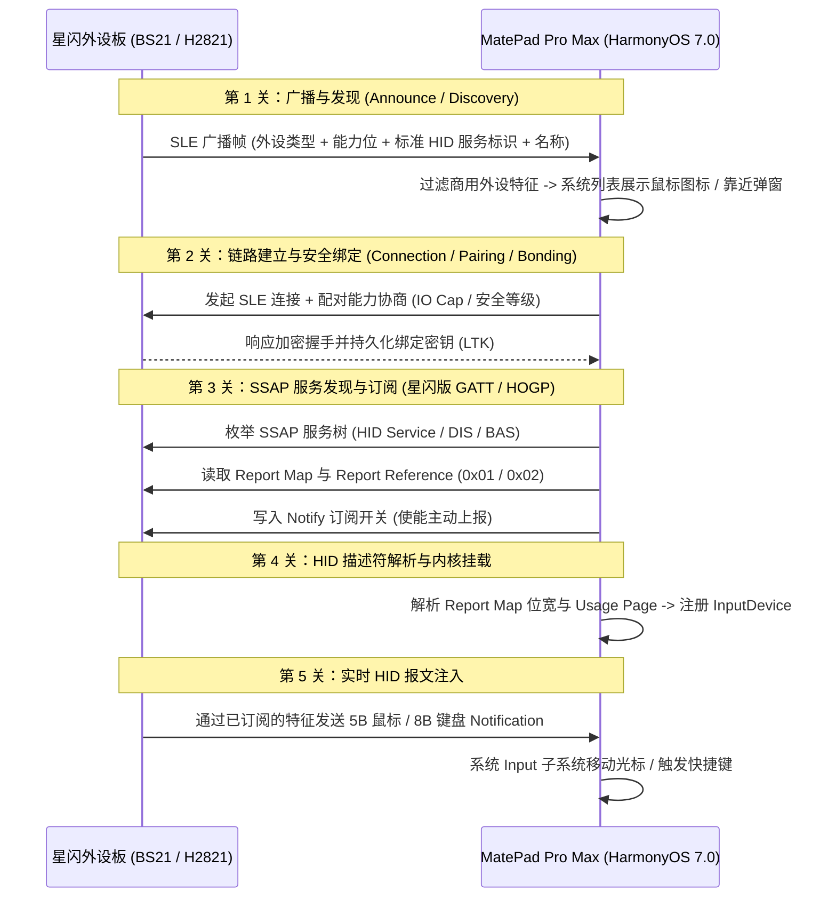
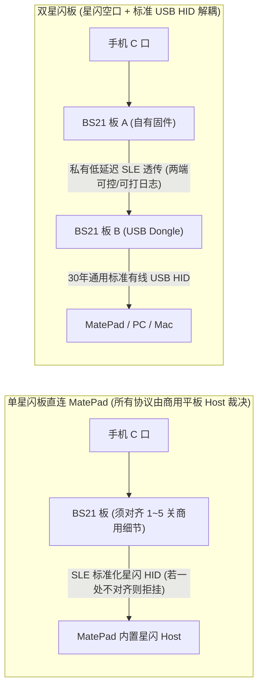

# 星闪（NearLink SLE）HID 协议对齐与排障全景图解

> 本文专门解释：**「单星闪芯片（如 BS21 / H2821）直连华为 MatePad Pro Max」时，协议栈原本应该怎么工作、所谓“对不齐”到底发生在哪一层的哪一个字段、以及对不齐时平板上会出现什么现象。**  
> 结合本项目前期 [Stage 1 真机排雷结论](../PROJECT_PLAN_AND_PROGRESS.md)（`nova 15 Pro + MatePad Pro Max 7.0.0.111`）做逐关对照说明。

---

## 一、 全景总览：一次「星闪外设 → 平板屏幕光标」要闯过的 5 道关

当一块星闪外设芯片不带专属接收器、直接连接 MatePad 内置星闪时，它和 MatePad 上的商用 HarmonyOS 7.0 星闪 Host 之间必须严格走完下面 5 个阶段的对齐握手；**任何一关的字段、权限或顺序对不上，后一关都不会触发，或者平板只显示“已连接”但屏幕毫无反应。**



### 为什么「单星闪板直连」和「双星闪板（板 A + 板 B USB Dongle）」差异巨大？



---

## 二、 第 1 关：广播与设备发现（Announce / Discovery）

这一关决定：**MatePad 打开“设置 → 星闪和蓝牙”或把外设靠近平板时，系统“看得见还是看不见你”、“把你当成键盘鼠标，还是未知小卡片”。**

| 对比维度 | 原本对齐时应该是什么样 | 具体哪里最容易没对齐 | 对不齐时的真实表现 |
| :--- | :--- | :--- | :--- |
| **可发现与连接标志** | 广播头明确声明处于**可发现 + 可被连接（Connectable & Discoverable）**的外设广播模式 | 开源 `fbb_bs2x` 部分低功耗测试例程只开定向广播、或广播间隔与标志位不符合通用外设扫描条件 | 平板打开星闪搜索界面**列表完全空白** |
| **外设外观 / 类型标识（Appearance）** | 按星闪联盟与 HID 规范填写明确的外设类别：**鼠标 / 键盘 / 复合输入外设** | 海思默认 `sle_mouse_with_dongle` 例程是做给**自家 USB 接收器（Dongle）**扫的，往往只带厂商自定义过滤字段，不带或写错标准外观类别位 | 平板可能根本不展示，或者展示成一个**通用默认图标 / “未知星闪设备”** |
| **服务标识声明（Service Data / UUID）** | 广播载荷里携带标准的 **HID-over-SLE 服务标识**，告诉系统 Host“我是输入外设，快来连我读描述符” | 广播包中缺少标准 HID Service UUID，或者填入的是仅限 `Dongle` 认识的私有测试 UUID | 无法触发“靠近发现”鼠标/键盘弹窗；手动点名称也常停留在浅层连接而非走 HID 驱动加载 |
| **字节编码顺序（Endianness）** | 广播 TLV 长度字段、UUID 小端/大端字节序严格按协议约定排列 | 手写 C 结构体组播帧时把 `uint16` / 128-bit UUID 字节序写反，或 TLV `length` 差 1 字节 | 平板扫描模块静默丢弃整条广播包，界面毫无动静 |

---

## 三、 第 2 关：连接与安全配对绑定（Link / Pairing / Bonding）

**即便广播看到了并点下了“连接”，输入外设（能操控系统指针、输入密码的键盘鼠标）在操作系统里属于高敏外设——Host 强制要求链路先加密绑定，才会去挂载 HID 驱动。**

> [!NOTE]
> **直接对照本项目真机踩坑历史**：  
> 在我们前期 Stage 1 **实验 4（BLE HOGP）** 中，`nova 15 Pro` 与 `MatePad Pro Max` 甚至连上并读完了 GATT 描述符，但由于双模配对过程未进入纯 LE 安全加密绑定，平板直接在 **订阅前中止断开**，从未发出最后的通知使能写入。星闪 HID 在这一关的安全门槛逻辑完全同理。

| 对比维度 | 原本对齐时应该是什么样 | 具体哪里最容易没对齐 | 对不齐时的真实表现 |
| :--- | :--- | :--- | :--- |
| **配对能力声明（IO Capability & AuthReq）** | 外设在配对请求响应中明确声明自己支持无屏幕确认（如 `NoInputNoOutput` — Just Works）及 **需要加密 + 绑定（Bonding）** | 透传例程默认关闭安全认证（明文连接），或误设为需要用户输入 6 位 PIN 码却没有串口/键盘回填能力 | 在平板上点设备名后**转圈 5~10 秒，随后提示“连接失败 / 配对被拒绝”** |
| **链路加密激活时机** | Host 发起启用加密后，外设必须在时限内完成加密响应，再继续后续 SSAP 读取 | 芯片固件未注册加密回调、或安全状态机和上层 SSAP 读请求时序打架，在链路未加密前返回 `Insufficient Authentication` 且未引导配对 | 平板直接断开连接；或者只完成普通 ACL 连接，随后系统底层静默放弃绑定流程 |
| **绑定密钥（LTK）持久化** | 首次配对成功后把长效密钥写入芯片 Flash（NV 存储）；下次靠近回连时用同一份密钥直接加密恢复通道 | 只存在 RAM 里未落盘、或芯片每次上电随机生成新地址却没配 RPA（可解析私有地址） | **第一次似乎连上了，但外设断电重插 / 平板熄屏再亮后彻底连不回来**，必须平板侧“忽略此设备”重配 |

---

## 四、 第 3 关：SSAP 服务树与通知订阅（星闪版 GATT / HOGP）

这是从“两台设备无线握手”迈向“系统认识鼠标和键盘”的**最核心一关**。

在蓝牙 BLE HOGP 中，系统依靠 GATT 服务树识别外设；在星闪 SLE 中，对应的规范叫做 **SSAP（星闪通用属性协议）**，同样要求外设服务端按标准树形结构注册服务、特征（Property）和描述符（Descriptor）。

### 原本对齐时，SSAP Server 的标准结构长什么样？

```text
BS21 / H2821 SSAP Server
├── 1. HID Service (标准星闪 HID 服务 UUID)
│   ├── HID Information        [只读 Read]              -> 版本号、国家码、支持远程唤醒等标志
│   ├── Protocol Mode          [可读 / 无需应答写]      -> Boot Mode (0) / Report Mode (1，复合键鼠必须支持)
│   ├── Report Map             [可读 + 要求加密认证]    -> 完整二进制 HID 报告描述符 (如本项目的 111B Combo)
│   ├── Input Report (鼠标)    [可读 / 主动通知 Notify] -> 5B 鼠标位移与滚轮载荷
│   │   ├── Client Config Descr (通知开关) [可读可写]  -> 平板写入“开启通知”，之后才能推坐标!
│   │   └── Report Reference               [只读]      -> { Report ID: 0x01, Type: Input (0x01) }
│   └── Input Report (键盘)    [可读 / 主动通知 Notify] -> 8B 键盘组合键载荷
│       ├── Client Config Descr (通知开关) [可读可写]  -> 平板写入“开启通知”，之后才能推快捷键!
│       └── Report Reference               [只读]      -> { Report ID: 0x02, Type: Input (0x01) }
├── 2. DIS (设备信息服务 Device Information Service)
│   └── PnP ID                 [只读]                  -> Vendor ID Source / VID / PID / Version
└── 3. BAS (电池服务 Battery Service，部分 Host 校验需要)
    └── Battery Level          [只读 / 可选 Notify]    -> 0~100% 电量值
```

### 常见 5 个「SSAP 没对齐」的坑点与后果

1. **只发私有透传 UUID，没有标准 HID Service**：
   - `fbb_bs2x` 的 `sle_mouse_with_dongle` 例程为了极简低延迟，服务端通常只建 **1 个自定义 UUID 服务 + 1 个私有特征**。这对自家 Dongle 够用，但 **MatePad 系统只认标准 SLE-HID UUID**，连上后因为找不到 HID Service，**平板界面显示“已连接”，但屏幕上没有任何光标**。
2. **多报告（鼠标 + 键盘）缺少 `Report Reference` 描述符**：
   - 我们的触控板采用 `0x01`（鼠标 5B）+ `0x02`（键盘 8B）复合描述符。如果不给两个 Input Report 特征分别挂上对应的 `Report Reference`，MatePad Host 就不知道哪个特征句柄收鼠标、哪个收键盘，**结果要嘛只认出半个设备，要嘛解析错乱**。
3. **Host 读 `Report Map` 时缺少 `Encryption / Read` 权限或缓冲区被截断**：
   - 111B（或更大的 PTP 400B+）`Report Map` 需要分片/完整读取；若芯片 SSAP MTU 太小或读取回调偏移量（`offset`）处理有 Bug，平板只拿到残缺的描述符，系统内核直接报错丢弃该 HID 设备。
4. **未处理好“通知订阅开关”（类似 BLE 的 CCCD）就往外猛发报文**：
   - 芯片侧必须等 MatePad Host **明确往通知配置描述符写入“开启通知”** 并返回成功应答后，发出的 Notify 包才会被平板输入栈消费；否则发送返回报错或被 Host 静默忽略。
5. **缺失辅助服务（`DIS / PnP ID` 或 `Protocol Mode`）**：
   - 商用系统驱动在创建输入设备节点前，常固定读取 `PnP ID` 与 `Protocol Mode`；哪怕鼠标 Notify 结构全对，缺了一个看似无关紧要的只读属性，部分系统驱动就会卡在初始化态然后超时断开（连接 1~3 秒自动掉线）。

---

## 五、 第 4 关：HID Report Map 描述符与报文载荷对齐

到了第 4 关，链路和 SSAP 都通了，决定性工作交给了 **HID Report Map 字节流** 与 **实际每次发送的 Payload 载荷**。

### 本项目已真机验证通过的 111B Combo 结构示例（参考 [HidDescriptors.ets](../entry/src/main/ets/protocol/HidDescriptors.ets)）

| 报告 ID | 所属集合 (TLC) | 实际 Payload 长度与字节定义 |
| :--- | :--- | :--- |
| **`0x01`** | 鼠标 + 双轴滚轮 | **5 字节**：`[Byte 0: 左/右/中键掩码+5bit填充]` + `[Byte 1: Rel X (-127~127)]` + `[Byte 2: Rel Y (-127~127)]` + `[Byte 3: 垂直 Wheel]` + `[Byte 4: 水平 AC Pan (Usage 0x0238)]` |
| **`0x02`** | 标准 USB 键盘 | **8 字节**：`[Byte 0: 8bit 修饰键掩码 Ctrl/Alt/Shift/GUI]` + `[Byte 1: 保留 0x00]` + `[Byte 2..7: 6 个并行键码]` |

### 具体哪里没对齐 & 会发生什么现象

| 没对齐的地方 | 详细说明 | 对不齐时的真实表现 |
| :--- | :--- | :--- |
| **1. Payload 字节数与描述符差 1 个字节** | 比如描述符声明鼠标是 5 字节（含水平 `AC Pan`），发包时却仍套用传统 4 字节鼠包；或者把 `Report ID (0x01)` 额外拼在 Payload 第 0 字节导致一共发出 6 字节（SSAP / 蓝牙 HID 通常由通道单独传 Report ID） | TX 包计数一直在涨，但 **光标纹丝不动**，或者按键字节被当成 X 坐标导致光标每次点击就往右下角飞 |
| **2. 忘记发「全 0 释放包」或修饰键顺序错位** | 按下组合键（如 `Alt+Tab`、`Meta+D`）发出非零键盘帧后，没跟上一帧全 0 释放包；或者同时松开所有位导致平板快捷键粘连 | **平板卡在 Alt+Tab 切应用窗关不掉**、屏幕狂重复触发同一快捷键，或者三指/四指手势失灵（参考 [ComboProtocolSession.ets](../entry/src/main/ets/protocol/ComboProtocolSession.ets) 中的 6 步错峰时序） |
| **3. 强行上报 `Digitizer / Touch Pad (0x0D / 0x05)` PTP 描述符** | 对照本项目 Stage 1 实验 2/3：MatePad 7.0 对三方无线外设的 `0x0D/0x05` 触控板描述支持极其挑剔 | 平板要嘛连接瞬间报错失败，要嘛在 `inputDevice` 里只把你归类为 **`mouse` 而非 `touchpad`**，紧接着因缺失期望的特征交互而超时销毁设备 |

---

## 六、 第 5 关：为什么「OpenHarmony 开源了星闪协议栈」依然会有对齐与排障问题？

开放原子基金会与 OpenHarmony 社区已经开源了星闪 Host 核心协议栈 `communication_nearlink_service`（包含设备发现、安全认证、SSAP 以及 HID/BAS/DIS 标准配置），这让我们**不用盲猜核心流程和标准 UUID**。但具体动手做到零售版 `nova 15 Pro + MatePad Pro Max` 上，依然有 3 层客观鸿沟：

| 层次 | 已开源的部分 | 仍存在鸿沟 / 闭源的地方 | 给开发者带来的真实影响 |
| :--- | :--- | :--- | :--- |
| **1. 平板主机侧（Host）** | OpenHarmony 标准版 `communication_nearlink_service` 源码公开 | 零售版 **HarmonyOS 7.0** 在开源底座之上叠加了华为商用策略（如靠近发现弹窗触发规则、商用鼠标兼容性认证策略、安全绑定强制策略） | 照着开源代码写 80%~90% 没问题，但剩下一两项商用策略细节（像之前 BLE HOGP 的 `CCCD` 拦截）只有真机跑一遍才知道过不过 |
| **2. 外设芯片侧（BS21）** | `fbb_bs2x` SDK 框架、LiteOS 配置以及 `sle_mouse_with_dongle` 等应用示例开源 | 底层 SLE 接入层/基带控制协议栈与 Controller 固件多以**静态库（`.a`）二进制**形式发布，且原厂主打示例是**双板配 Dongle 的私有透传**，不是“对接华为平板的标准 SLE-HID 外设” | 需要开发者自己依据 OpenHarmony HID 规范把 `BS21` 改写成完整标准 SSAP HID + 加密绑定服务端 |
| **3. 排障可观测性（Debug）** | 本机手机串口日志、开发板自己串口日志全部可见 | **零售未 Root 的 MatePad Pro Max 看不到系统星闪底层拒连日志**，且市面缺乏几十元级别的星闪空口协议分析抓包仪 | **一旦前 4 关某一比特对不上，手机端收不到平板一句具体的报错码**，只能靠改参数反复试（“黑盒排障”） |

### 反观「双星闪芯片（发射板 + USB Dongle）」的工程本质
- 发射板 ↔ 接收板（Dongle）之间的星闪链路**两端都是你自己的代码**，两边都能插线看完整串口日志，直接复用海思原厂最成熟稳定的透传例程，**几乎没有协议对齐黑盒**；
- 接收板（Dongle） ↔ MatePad 之间走标准有线 **USB HID**，完全不依赖平板是否开启星闪开关、不看平板星闪白名单，并且能以 **1000Hz+ 回报率** 稳定工作，甚至能直接验证 **USB 原生多指 PTP 精密触控板**。

---

## 七、 故障现象速查表（真机踩坑对照）

当你后续拿到开发板实测“单板直连 MatePad”时，可以用这张表快速定位问题卡在第几关：

| 平板实测现象 | 大概率卡在哪一关 | 最优先核对的协议字段 / 动作 |
| :--- | :--- | :--- |
| 平板星闪/蓝牙列表里**完全搜不到开发板** | **第 1 关（广播与发现）** | 检查 `Discoverable/Connectable` 广播标志、广播载荷里是否携带标准 SLE-HID 服务 UUID 与外设外观类型 |
| 搜到了设备名，但图标不是鼠标且**一直弹窗/连不上（5~10s 超时）** | **第 2 关（安全配对绑定）** | 检查 IO Capability（设为 `NoInputNoOutput`）、是否开启了加密+Bonding 能力、以及加密回调应答 |
| 第一次能用，但**重启开发板或平板熄屏后连不上** | **第 2 关（密钥持久化）** | 检查芯片端是否在配对完成回调里将绑定密钥（LTK）写入 Flash，以及地址类型是否固定 |
| 平板设置里显示**“已连接”，但屏幕没有光标** | **第 3 关（SSAP 服务树）** | 核对服务 UUID 是否是标准 SLE-HID（别误用 Dongle 私有 UUID）；核对是否挂了 `DIS (PnP ID)`、`Protocol Mode` 与正确的 `Report Reference` |
| **刚显示“已连接”过 1~3 秒就自动断开** | **第 3 关 或 第 4 关** | 检查 `Report Map` 长度/读取偏移（MTU 分片）、加密读权限是否放行；若发了 PTP (`0x0D/0x05`) 描述符则说明驱动拒认，退回 `Mouse + Keyboard` |
| 有光标但**不动 / 点击乱飞 / 按键卡住** | **第 4 关（Report 载荷）** | 核对发包字节数是否与 Report Map 严格一致（5B 鼠标别发 4B、也别把 Report ID 塞进 payload）；每次发完键值后必须补全 0 释放帧 |
| 开发板代码自己明明按 OpenHarmony 对齐了，还是不知道哪一步被拒 | **第 5 关（商用黑盒）** | 判断调试时间成本；若耗费过多时间定位黑盒，**直接加第 2 块同款板刷成 USB Dongle**，立刻 100% 跑通低延迟星闪方案 |
